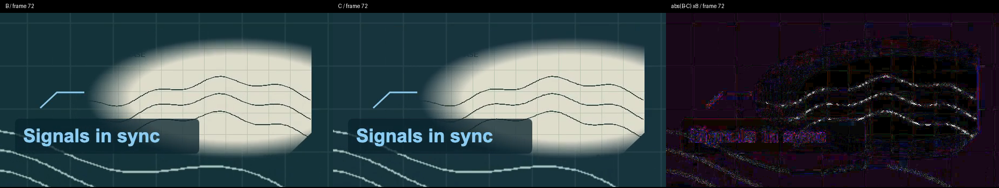

# 一层 React 遮罩能否直接改变画中画？

2026-11-23 · 单作品 B/C 边界实验 · macOS arm64 / Apple M2

**能。** B 把实际画中画作为 React 遮罩的子节点。C 让 Chromium 输出逐像素透明度，FFmpeg 把它乘进同一画中画的 alpha，再叠回主视频。两路都完成了有透明孔、移动柔边、几何裁切、半透明字幕与矢量字形的 8 秒作品。C 在相同最终编码器的一对实测中用时 7.21 秒，B 用时 16.82 秒。C 值得保留为候选。生产选型还取决于要支持的组件是否需要读取下层画面，以及审片是否需要整片实时交互。[B 成片](evidence/B-m4a.mp4) · [C 成片](evidence/C.mp4) · [实验清单](evidence/manifest.json)

## 同一份作品如何进入两条路径

基线 V3 的作品 ID、对象 ID、两个源视频及源窗、三条声音、音量、时间轴和字体保留。子版本 V4 改了标题源码、画布位置和尺寸，声明目标对象为既有的 sensor-film。先用仓库的 CompositionContent、validate_content 和 content_digest_of 校验，再由 compile_video_spec 编译普通轨道。两条路径从这一份派生数据取出同一 PiP、MG 与普通轨道。输出为 1920×1080、30 fps，第 0–239 帧。两路逐帧 PTS 均精确等于 k/30。画中画第 15–209 帧可见，MG 第 30–179 帧生效。字体文件 SHA-256 已核对，B/C 的 Chromium 均实际选用 Arial-BoldMT，CDP 各读到 15 个字形。[V4 作品](evidence/version.json) · [共同渲染数据](evidence/data.json) · [派生与输入校验](src/prepare.py) · [字体及输出身份](evidence/manifest.json)

源项目中的 Scene 引用仓库 Video 和宿主 Remotion，Boundary 导出两个受控 React 组件。实验从工作副本加载清单中相同摘要的源码。这个受信入口依赖本地宿主适配，未作为可独立装载的 Generator 工程验收。每次源码修订应启动新的隔离目录，目录内的 bundle 缓存按单一固定版本使用。[共同视觉源码](src/Boundary.tsx) · [B 场景](src/scene.tsx) · [隔离构建](setup.sh)

| 实现责任 | B | C |
|---|---|---|
| 目标与顺序 | 按目标 ID 取现有 PiP，置于 Aperture 子树，再绘 Caption | 同一目标被切为遮罩前、中、后三个显示区间，活动区间接收浏览器的 coverage |
| 画面交换 | Remotion 渲染包含两路视频的最终 React 树 | Chromium 在 1160×310 RGBA 面上同时画覆盖率和字幕。FFmpeg 从左半取 PiP alpha，从右半取绘制结果，逐帧管道传输 |
| 时钟 | Sequence 提供相对帧，OffthreadVideo 选源帧 | 有理数 PTS 映射、源窗、输出帧、两张平面及裁切后的音频窗口由适配器对齐 |
| 新的维护责任 | 原 B 场景入口 11 行，本轮场景加注册 25 行 | 原合成、绘制、构建共 88 行，本轮对应实现 83 行。另有 13 行常驻逐帧进程，需要自己维护浏览器与出帧服务 |
| 外部依赖 | 延用已锁定的 Remotion renderer、bundler、Player、React 和 Chromium | 延用 React、esbuild、Playwright/CDP、Chromium、PyAV 与 FFmpeg。视频始终留在 FFmpeg |

行数为含空行的物理行，仅描述本夹具。B 的 Node 渲染入口原 26 行、本轮 15 行，复用了产品 Video。共享视觉组件从 18 行变为 27 行。C 合并了原先分开的构建步骤，较短的源码也承担了更多时钟和顺序约定。预览服务、自动化和取证脚本独立列在 src。C 对本作品只需要一个目标和两张有固定空间含义的平面；通用层栈、跨层位移、backdrop-filter、任意多对象排序仍缺少证据。本次没有把视频帧送回 Chromium，也没有为同一遮罩另写一套 FFmpeg 形状公式。[C 浏览器侧](src/planes.tsx) · [C 合成侧](src/c.py) · [实际平面样本](evidence/planes-072.png)

## 任意帧与实际播放器

在两个真实浏览器页面通过滑杆按 72、179、0、30、156、180、239、45、60 乱序定位。覆盖首尾、入场、离场和两处源 PTS 中点。每个 B 检查点另外调用 renderStill。C 的滑杆向常驻进程请求从原素材新算目标 PNG，无需先导出整片。记录了最终浏览器截图及每帧与交付 MP4 的 RGB 差。主视频从画面二进制编号直接解码；PiP 的编号会被遮住，因此在未被遮住、alpha 为 255 的运动曲线上与原视频相邻 7 个候选做像素匹配，CSV 同时记录次佳差距。[播放器代码与测试](src/preview.py) · [逐点 UI 事件](evidence/preview-events.json) · [预览逐点比较](evidence/preview-comparison.json) · [PiP 判别源码](src/source_ids.py)

| 检查 | B | C |
|---|---:|---:|
| 交互定位的主视频源帧与自身导出一致 | 1/9，其余早一源帧 | 9/9 |
| 可见 PiP 的交互定位源帧与自身导出一致 | 3/7 | 7/7 |
| 独立定位图与自身导出的主视频源帧一致 | renderStill 9/9 | 源帧接口 9/9 |
| 全片导出 PiP 与最近 PTS、中点取后帧一致 | 192/195 | 195/195 |

B 在第 60 帧的浏览器媒体时钟已经到达主视频 2.5 秒、PiP 1.9 秒；像素仍是 59、47，导出是 60、48。离线 still 可以作为精确审片入口。两个导出在 PiP 的 72、126、156 帧恰好选取等距的不同邻帧。逐帧匹配中，最佳与次佳候选的最小 MAE 差超过 13.9。[B 第 60 帧 Player](evidence/player/ui-B-60.png) · [B 第 60 帧离线 still](evidence/player/B-60.png) · [完整 PiP 源 PTS](evidence/pip-source-ids.csv)

C 的 9 张 UI 截图与新算源图逐像素一致，相对本路有损导出的全帧 MAE 为 0.76–2.21/255。单帧 UI 定位含浏览器等待，实测 0.17–0.30 秒，其中首次包含懒启动。另从源独立渲染 [54,84) 的一秒音视频，在原生 video 控件播放，实际播放时钟前进且计到 15 个视频帧。该段解码的 30 个主视频源编号全部与整片相同，帧 MAE 为 0.76–0.84，音频与相应参考窗口互相关滞后为 0。段长为 48,000 个呈现采样，解码器最后返回的 AAC 块含 128 个额外采样。自动播放时静音，音频验证直接针对编码数据。这里验证了逐帧审片和有限区间播放；逐帧接口的实测延迟不支持把它宣称为 30 fps 实时全片编辑器。[C 第 60 帧 UI](evidence/player/ui-C-60.png) · [实际播放片段](evidence/player/segment.mp4) · [片段逐帧比较](evidence/playback-window.json)

## 局部误差从哪里来

重新解码上轮 V3，复得全片 MAE 2.3232/255。按当帧实际活动的标题及 PiP 矩形划分，**96.18% 的绝对误差位于两者之外**，这部分占 89.23% 的像素。上轮误差的主要面积来源是主视频路径。这个空间归因不区分解码、缩放、色彩转换及最终编码各自的贡献。[旧成片的重新测量](evidence/baseline-crosscheck.json)

本轮 V4 全片 MAE **2.471/255**，PSNR **38.46 dB**。下表均按区域内实际像素加权；子区域会交叠。软边、全遮和全透区域依据 Chromium 真实输出的 alpha 分类，均剔除字幕覆盖。平坦与细节根据左侧无遮挡区域的局部 RGB 梯度选取。亮色字形区域还可能包括同墨色矢量线条。[240 帧区域明细](evidence/frame-regions.csv) · [区域定义与计算](src/analyze.py)

| 主视频左侧区域 | 平坦采样 | 细节采样 | PiP 隐藏处 | PiP 柔边 | PiP 完全可见 | 字幕绘制区域 | 高亮实色墨迹 |
|---:|---:|---:|---:|---:|---:|---:|---:|
| 2.487 | 2.320 | 3.613 | 2.349 | 2.247 | 1.525 | 2.504 | 4.834 |

第 72 帧对未编码的 B still 与 C PNG 做单变量试验。左侧无遮挡区域默认 MAE 为 1.673，仅改变 C 的输入矩阵假设 601→709 得 1.940，仅把 bilinear 改为 bicubic 得 2.765。两项都会变动误差，此处均未改善。该帧 PiP 恰好相差一个源帧，差图能看到移动曲线；其他帧也有色差与纹理差。现有证据可排除“主要差异都来自字幕柔边”，无法单独量化字体抗锯齿或每个色彩转换步骤的份额。[单变量数据](evidence/quality.json) · [第 45 帧](evidence/comparison-045.png) · [第 72 帧](evidence/comparison-072.png) · [第 156 帧](evidence/comparison-156.png)

## 42.667 ms 的来源与修正范围

复现了实际 Remotion 4.0.484 的编码与拼接子命令，在同一 libfdk_aac、输入 WAV、采样率及码率下，仅把中间编码命令的容器参数从 ADTS 切为 MP4。两种路径都由原流程直接产出最终文件。以三个固定 WAV 独立构造 384,000 采样的参考混音，并逐阶段解码比对。[ADTS 子命令](evidence/adts/commands.jsonl) · [MP4 子命令及首次失败](evidence/m4a/commands.jsonl) · [逐阶段采样记录](evidence/audio-stages.json)

| 观测点 | 首包 PTS，以 48 kHz 采样计 | 跳过采样 | 解码采样数 | 实测整轨滞后 |
|---|---:|---:|---:|---:|
| 编码前 merged.wav，两路相同 | 0 | — | 384,000 | 0 |
| ADTS 中间文件及其最终 MP4 | 0 | 无 | 386,048 | +2,048 |
| MP4 中间文件及其最终 MP4 | −2,048 | 2,048 | 384,000 | 0 |
| C 直接输出 AAC/MP4 | −1,024 | 1,024 | 384,000 | 0 |

原链把含有编码器前导采样的音频写入 ADTS，中间容器没有保留起始时刻及跳过前导采样的元数据。最终拼接用音频 stream copy，从时间零呈现了这些采样。MP4 中间件保留负 PTS 与 skip_samples，最终呈现起点正确。上轮原始 A、B 与本轮原始 B 的全部 AAC 包载荷摘要一致；两种封装对照内，中间包载荷与各自最终成片一致。跨两条封装路径的 AAC 包载荷摘要不同。B 两份最终视频的 H.264 包载荷摘要相同。修正 B/C 全片无削波采样，参考相关分别为 0.9892、0.9915。正式修正应保留编码器给出的延迟，固定减 2,048 只适用于这个编码器配置。首次尝试 ipod muxer 被所锁二进制拒绝，退出 1；改用该二进制支持的 mp4 muxer 后通过。正式 Renderer 仍沿用原实现。[原始 B 成片](evidence/B-adts.mp4) · [直接对齐的 B 成片](evidence/B-m4a.mp4) · [原始失败](evidence/failed-ipod.log) · [与历史 A/B 音频包交叉核验](evidence/baseline-crosscheck.json)

## 性能、复现与裁决

| 同机整片运行 | B 耗时 / 采样峰值进程树 RSS | C 耗时 / 采样峰值进程树 RSS |
|---|---:|---:|
| 初次，含本路首次构建 | 20.00 s / 2,129 MiB，原始 ADTS | 7.44 s / 850 MiB |
| B 热 bundle，直接保留音频前导信息 | 16.61 s / 1,904 MiB | — |
| 热来源、统一 FFmpeg 9 / libx264 / 2 线程，单对 B→C | **16.82 s / 1,692 MiB** | **7.21 s / 849 MiB** |

统一编码对照相差 **9.61 秒（57.1%）和 843 MiB（49.8%）**。最终编码均用 veryfast、CRF 18、192 kb/s AAC。这一对测量没有估计多次运行的分布，RSS 约每 0.2 秒采样；差值包含两路实际解码、栅格面积、像素传输及调度。历史 A→B 的首次去烘焙收益为 11.16 秒，修改标题节省 8.03 秒。这两个问题独立计算。为音频诊断使用的原始 B 仍采用锁定的自带 FFmpeg；逐帧画质表比较的是修正封装的 B 和 C。统一编码成片另有摘要。[本轮完整计时与失败](logs/bench.jsonl) · [统一编码命令](evidence/equal-args.jsonl) · [旧 A→B 与 B→C 实验](../baseline/REPORT.md)

从仓库交付脚本另起空目录，执行 npm ci 后全流程成功。五个成片、作品数据、逐帧指标与音频诊断均复得相同 SHA-256。第二次统一编码对照 B 为 16.36 秒 / 2,241 MiB，C 为 7.30 秒 / 850 MiB；B 的采样峰值随运行波动。回放日志保留了关闭页面时 Range 连接提前结束的 BrokenPipe，另存了首次字体取证因缺少 font.sha256 停止的记录。补入基线字体摘要后，通过两路实际字体核验。[干净安装复现摘要](evidence/replay/comparison.json) · [复现计时](evidence/replay/bench.jsonl) · [复现原始日志](evidence/replay/run.log) · [字体探针首错](logs/provenance-first-failure.log)

**评审判断。** 这次暴露的 C 成本主要是稳定的目标绑定、平面语义、时钟和预览服务。对单目标 alpha 遮罩，这些成本可界定，性能收益仍在。B 的跨层表达最直接，适合作为复杂场景的参照实现，又有已验证的 renderStill 审片路径。当前证据足以支持 C 继续作为候选，未覆盖任意 React 混合、完整交互编辑器或生产 ExportJob。若批准唯一主仓切片，最有直接回归证据的是共用 A/B 的 AAC 中间封装及采样级验收；本次交付停在仓库内实验资料。[运行入口](run.sh) · [人工预览入口](src/serve.py)
