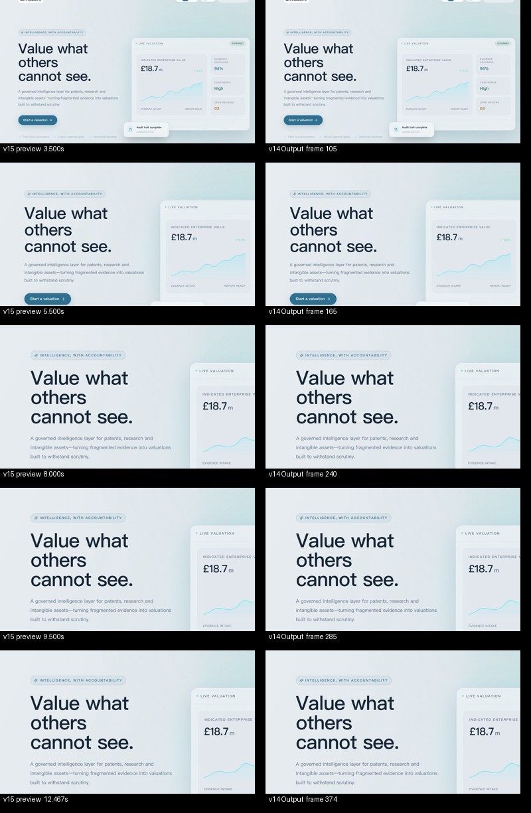
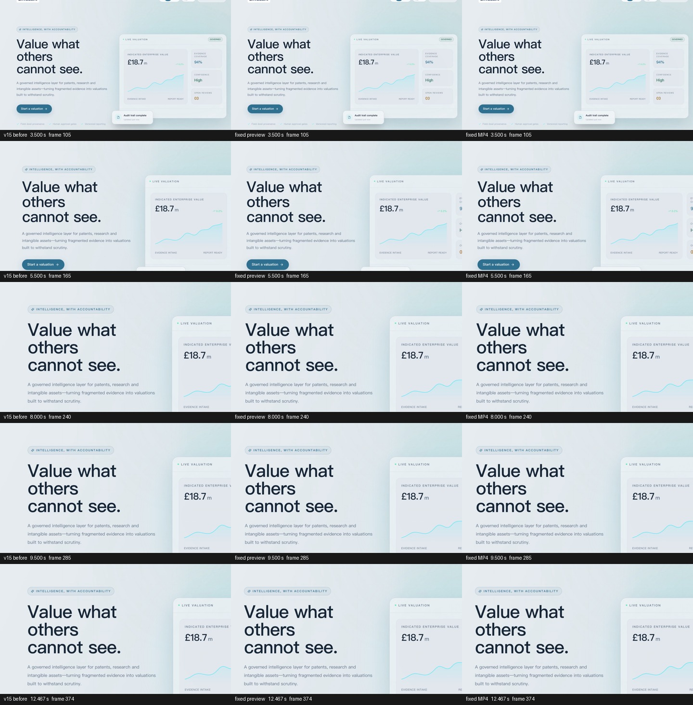

# I7 第一批验收

2026-11-22，main 开工版本 `e5f14ca3`。I7-0 复现原缺陷，I7A 通过断进程恢复，I7B 在干净的 v15 副本上通过原句编辑和全段视觉验收。[数据库、预览、恢复装配与 Chrome 实测数据](audit.json)

## I7-0 · 第二镜头的运动来源

独立 PostgreSQL 5966 上的 I6 库为 `rep_u4r_20261122`，迁移版为 `j6d05_project_brief`。以 PostgreSQL TEMPLATE 复制到 `rep_i7_9x2iij`，保留项目、版本链、原 opening、六段旁白、快照和 Output 身份。副本与原库开工 head 均为 v15（379d8dd6）。共享 5432、历史项目及正式 MP4 保留。隔离 API 19981 与 Renderer 19987 用于渲染，19881/19889 用于旧 Chat 卡回放。没有启动共享 API。

| 能力 | 实际证据与边界 |
|---|---|
| 动画读取与定位 | 审计者通过生产 inspect_clip 读取 v15 的所选 WebObject。v13–15 数据库均有同一网页快照、缩放和位移轨迹。原工具只提供属性名。I7 增补所选片段两类整对象动画的 ID、target、局部 tick、值和 easing。最终模型由 inspect_timeline 定位第二镜头，再以 inspect_clip 读取两个真实动画。 |
| 初稿与求值 | 固定网页 view 提供底图。web_shots 将取景写为 Clip.animations。video_spec 将局部 0、364500、810000 tick 编译为 0、122、270 帧。Video.tsx 调用 evaluateProperty 按 object ID 和属性在片段局部帧求值。三个点均为 linear。第 270 帧是右开结束边界。Preset 注册表和 animation.py 的 TextPart 切分均不负责这里的逐帧运动。 |
| 修改已有点 | 首错发生在原生编辑面。静态 scale / translate 拒绝动画接管的属性。UpdateClip 的 animations 字段使用整列表替换。新增 set_keyframe 以 clip、动画 ID、已有 tick 和数值为输入，服务端从固定 base 完整保留同级动画与 easing 后提交 UpdateClip。PostgreSQL fixture 已检验值变更、类型拒绝、重放与旧 base 冲突。 |
| 播放与输出一致性 | 生产 prepare_saved_video_scrub 与 /preview 渲染 v15 第二镜头 3.5–12.5 秒，解码 270 帧。v14 正式 MP4 相同镜头数据逐帧对应 105–374，缩至 384×216 后逐像素 RGB 平均绝对误差 0.159/255，单帧最大均值 0.230/255。v17 新版也已对照同版正式文件，详见 I7B。 |
| 版本、恢复与重放 | 复用 opening/call ID、唯一写口和 CAS。旧 opening 的恢复装配可重建。I7A 最终样本完成真实进程中断后续跑。 |
| 专业操作范围 | 工具限整对象缩放与二维位移的已有点值。新增、删除、移动点及其他专业操作均未纳入。 |

左栏为新渲染的 v15 预览，右栏为 v14 正式文件。五个时间点覆盖镜头开始、推近中、原缺陷帧、推近后和最后可见帧。画面中估值卡标题在 8.000 秒已越过右边界，到 12.467 秒仍裁切。

## I7A · 恢复通过

验收项目预置一张 2 秒原生文字卡。之后的检查、编辑、预览、申请导出、审片与交付全部由真实 MiniMax 从 Chat 发起。进程注入器等待原生 wait_for_media_result 返回已成功的真实回执，在发送下一条模型请求前对隔离 API 执行 SIGKILL。新 Python 进程调用 Worker 生产入口 resume_job_receipts 扫描持久回执。

| 尝试 | 首错与处理 |
|---|---|
| 439f31ac | 模型先延长后预览。既有观察前置判断没有识别「先检查并预览」。修复该顺序判断，首份报价保留，未批准导出。 |
| f26145d2 | 杀进程成功。恢复载荷带有 v2 已完成 extend_still，审片后工具投影重新开放写入，模型又延长一次到 v3。保留失败版本。新提出的 8 积分报价没有入队。原 MP4 单次扣 6。 |
| f025fe89 | 禁止恢复续行重复写入后，审片模型只看到 3 秒的文件与 3 秒的已导出版本，错误要求延至 4 秒。反复审阅后，Chat 降级回复还错误否认已保存和制作。审片输入补入直接父版和已导出版的真实时长；降级回复读取已导出/已交付事实。样本只扣 6。 |
| d61bbe0b | 相同自然语言，先 inspect_timeline、预览 2 秒，再 extend_still、复看 3 秒、批准导出。SIGKILL 时 v2、Output 与成功回执均已提交。恢复模型的实际请求包含原 opening、extend_still v2 及固定 Output。两次 review_video 后一次 deliver_video。全程只有 v1、v2，一个 Job、一次认领、一次 capture 6 和一张交付卡。Chrome 刷新前后均可播放，下载 90 帧，SHA-256 与数据库相同。 |

最终 opening 为 `1073df50-f8e8-4f76-902f-7517154cc10e`，v2 为 `882407af-ce03-4d82-b95a-abec84c2a571`，Output 为 `1b8f066c-c441-5acb-9ce2-be7461e46e4e`。Chrome 下载的 90 帧 MP4 的 SHA-256 为 `a8677e48ca9e6fb835b7abc881715650cca4008e9d986e1a8ce97de18c89b34a`。恢复前后的 provider 请求和持久交付共用原 opening。[真实旅程与交易](journeys.json)

## I7B · OxValue 第二镜头通过

验收原句为「第二个镜头推近的时候，右边估值卡的标题被切掉了。保留推近效果，把它调整到完整可见，然后播放这一段给我看。」三个数据库分别继承同一 v15。对模型只提交自然语言，原镜头标识、问题帧及工程核验数据留给验收者。保留所有历史尝试和 Output。

| 副本 | 首错、修改与结果 |
|---|---|
| rep_i7_9x2iij | 模型先使左侧文案越界，修订至 v21 时两处标题可读，但独立检查发现新增左黑边。正式回执也曾误报缩放，后续重新 inspect_clip 更正。补充取样图大小、与画布同色的实际边缘像素和写入后动画回执。此副本后续尝试至 v35，止于已保存、后续未完成，只有 v21 正式导出。 |
| rep_i7_cvb3nw | 同一原句得到 v19，右标题可读，四边未露底，但左侧原本可读的主标题被裁。模型只检查点名文字，不能据此判构图通过。补明位移的坐标方向及复看时保留其他可读前景的要求。无新导出。 |
| rep_i7_dki6p4 | 从干净 v15 重新提交原句。模型读取时间线与目标动画，真实预览 3.5–12.5 秒，自主发出两个 set_keyframe，随后复看 v17 同一窗口。独立验收通过后批准正式导出。模型审阅并交付同一固定版本。 |
| 最终 Chat | 验收中只要求播放的开场也触发了一次导出报价。回溯到历史交付被投影成新交付目标，已纠正上下文并补定向回归；此次真实旅程的报价在授权后才入队。之后 Chrome 发现已回答的费用问题丢掉同消息里的两张已存预览。补回现役问题前置消息的 blocks 后，在同一真实消息验证了两张卡的播放及刷新。 |

最终 opening 为 `134cce3a-80b5-45ff-a246-5192dde7c870`。在输入、工具请求和版本表中交叉核对，写入均由 MiniMax-M3.1-Flash 决定。两个调用顺序生成 v16 和 v17；回查 v15 至 v17 的 settings、sources、scenes、timeline、creative_state 与 skill_provenance，全部差异如下。

| 片段局部时点 | 已有水平位移 | 新水平位移 | 垂直位移 |
|---|---:|---:|---:|
| 4.05 秒（364500 tick） | 495.3 | 385 | 150.3 |
| 9 秒（810000 tick） | 505.2 | 385 | 153.3 |

目标为 `clp_scene_2_source / obj_scene_2_source / anm_scene_2_position`。原始缩放 1.08 → 1.516 → 1.531、初始位移和所有 easing 均相同。六段旁白的 Clip、快照和 digest、其他镜头及 66.5 秒总长相同。原库收工仍为 v15，只有旧的两项 ExportJob。修复版 v17 为 `4001a07f-6a78-4572-b361-58a72b201172`。[版本、模型调用与费用](journeys.json)

### 画面、审阅和交付

- 模型的每次局部观察都发送该版的 9 秒 MP4 及标注图。局部图为 3.500、7.967、12.467 秒，修订后另有同窗基线对照。正式审片中再次读取第二镜头 16 个有序采样点。连续动态证据由独立逐帧解码提供。
- 对全部 270 帧，用首帧完整文字区域、实际缩放与局部图像配准定位右侧标题和左侧主标题首行。右侧标题最小右边距 14 px，左侧主标题最小左边距 94 px，两处相邻帧最大位移分别为 3.17 px 以内和 1.42 px 以内。逐帧画布四边露黑检测最大值均为 0 px。原推近保留，目标没有瞬时越界或明显跳动。
- 在成片第 105、165、240、285、374 帧另做 OCR 并看图。五个时刻均读出左侧三行主标题、右侧完整的 INDICATED ENTERPRISE VALUE 与 £18.7m。用户点名的标题完整，卡片装饰区在推近末段仍超出画面。
- v17 局部预览的 SHA-256 与发送给模型的文件相同。对齐新正式文件第 105–374 帧，缩至 384×216 的 RGB 平均绝对误差为 0.165/255，单帧最大均值 0.224/255。
- 正式 Output 为 `511ca95b-4d2b-5404-8026-7bed0e8ad627`。Chrome 实测刷新前后播放、下载 18,659,738 字节、1920×1080、1995 帧，SHA-256 为 `b1f66943f22700a45eabc94e49e5354bc283db02577e0378b9688360546974a8`。同一 Chat 的原 v15 和新 v17 窗口刷新后均可播放。[9 秒局部预览](scene-2-preview.mp4) · [66.5 秒正式 MP4](https://repurposer.tos-ap-southeast-1.volces.com/exports/2e9aa435-b240-4c6c-a63d-439fe4014dc3/837057ff-545f-44c0-a61f-9fa93ce54343/511ca95b-4d2b-5404-8026-7bed0e8ad627.mp4)

### 六面裁决

| 面 | I7-0 基线 | I7A 最终恢复任务 | I7B 最终修复任务 |
|---|---|---|---|
| Tool | 通过，定位原生动画与原读写缺口 | 通过，一次延长、一次导出、一次交付 | 有条件通过，两个有效写入和两次同窗预览，另有一次多余报价 |
| Context | 通过，核对旧版本、对象与六个既有点 | 通过，恢复模型实收原 opening 的已保存编辑与已成功 Output | 有条件通过，定位和审片依据正确；本轮对多余报价的最后修正有定向回归，未重跑完整模型旅程 |
| Chat | 通过，历史回执和两张旧交付卡可读 | 通过，单张原 Output 卡，费用和时长如实回报 | 通过，两张版本预览和单张正式交付卡可回放，末次审片说明采样范围 |
| Execution | 通过，生产 Renderer 复现右侧裁切 | 通过，v2、一个 ExportJob、一次认领、一次实际扣费 | 通过，只改两个水平坐标；新版预览、独立画面、正式文件和下载均核实 |
| Recovery | 有条件通过，基线只读重建原 opening | 通过，SIGKILL 后新进程续行，无重复编辑、费用或交付 | 有条件通过，版本 CAS、同请求重放及旧版本可读已验证；关键帧写入瞬间未另注入进程故障 |
| UI | 通过，旧成片在 Chrome 刷新前后播放和下载 | 通过，刷新后沿原卡播放、下载 | 通过，在原 Chat 比较两版局部预览，刷新后打开及下载同一正式 MP4 |

本批所有尝试共 capture **284 积分**，其中 I7A 的三次独立导出各 6 分，I7B 的 v21 试验文件和最终 v17 各 133 分；最终两条通过的旅程合计 139 分。数据库中 MiniMax 会话计量合计 **0.319653 美元**，供应商最终账单未取得。本批没有生成新旁白或发起社交发布。定向 API/数据库回归 91 项通过，Chat 历史与挂载回归 34 项通过，Web TypeScript 检查通过。

### 本批修改文件

| 目录 | 文件 |
|---|---|
| apps/api/app/chat | editor.py、editor_recovery.py、plan_turn.py、prompts.py、service.py |
| apps/api/app/tools/video | preview.py、review.py |
| apps/api/test/core | test_delivery.py、test_editor_split.py、test_previews.py、test_provider_tools.py |
| apps/web/src/components/chat | AgentThread.tsx、timeline/history.ts、timeline/history.test.ts |
| apps/web/src/lib/i18n/locales | en.ts、zh.ts |
| docs | CHAT_ARCHITECTURE.md、PROGRESS.md、RENDERING.md、VERIFICATION.md、VIDEO_EDITOR.md、VIDEO_PROJECT.md |
| docs/tasks | new-agent.md |
| docs/tasks/agent-editor-evidence/iteration-7 | README.md、audit.json、journeys.json、scene-2-baseline.jpg、scene-2-preview.mp4、scene-2-repair.jpg |
